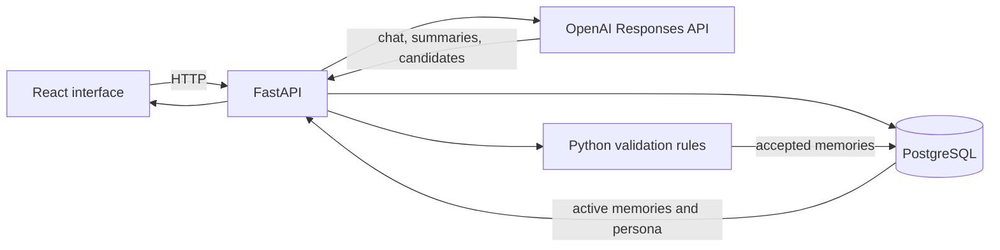
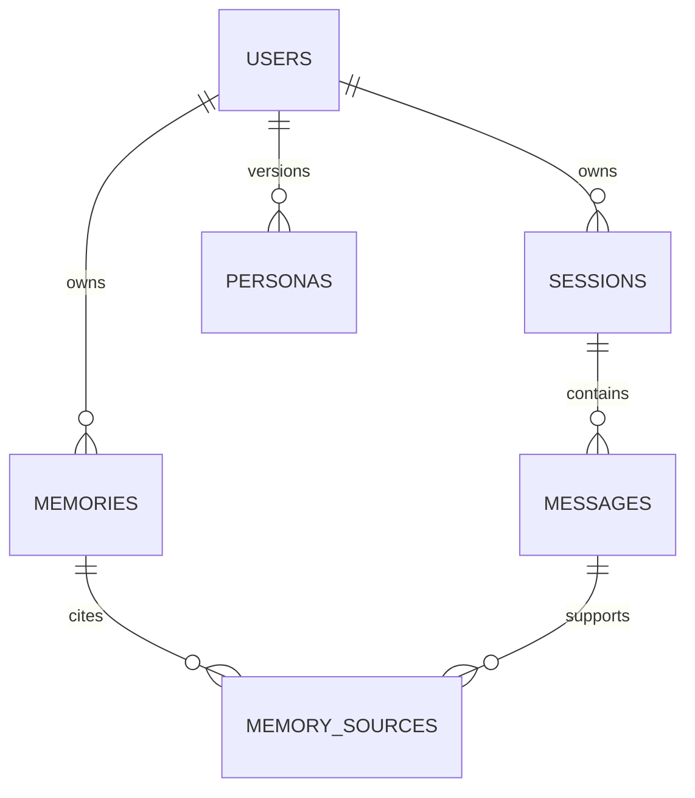

# Recall Commerce

Recall is a memory-first conversational commerce demo. It turns session messages into evidence-backed preferences, lets the user inspect or correct those preferences, and applies active memories to later conversations.

This is an independent portfolio project by Yousef Al-Salqan. It is inspired by personalization problems in commerce and is not affiliated with or endorsed by DoorDash.

## What the demo proves

1. A user states durable preferences in one session.
2. The backend stores each message and maintains a rolling session summary.
3. Ending the session extracts structured memory candidates.
4. Deterministic Python rules validate, merge, and score candidates.
5. Active memories generate a versioned customer persona.
6. A later session receives those memories as context and explains which ones were used.

Supported memory categories:

- Dietary restriction
- Allergy
- Cuisine preference
- Budget
- Merchant preference

Allergies and dietary restrictions are accepted only from explicit user statements. Inferred cuisine, budget, and merchant preferences remain candidates until they are supported by separate sessions.

## Architecture





The LLM proposes structured outputs. It never owns the safety rules, confidence calculation, consent decision, or database merge behavior.

## Stack

- React, TypeScript, Vite
- Python, FastAPI, Pydantic
- PostgreSQL, SQLAlchemy, Psycopg, Alembic
- OpenAI Responses API with Pydantic structured outputs
- pytest, Vitest, Playwright, Ruff, ESLint
- Docker Compose for local PostgreSQL

## Run locally

Requirements: Python 3.12 or newer, Node.js 22 or newer, npm, Docker, and Git.

Copy `.env.example` to `.env`, then start PostgreSQL:

```powershell
docker compose up -d
```

Set up and run the API:

```powershell
python -m venv .venv
.\.venv\Scripts\python.exe -m pip install -e "backend[dev]"
cd backend
..\.venv\Scripts\alembic.exe upgrade head
..\.venv\Scripts\uvicorn.exe app.main:app --reload
```

In another terminal, run the React app:

```powershell
cd frontend
npm install
npm run dev
```

Open `http://localhost:5173`. Interactive API documentation is available at `http://localhost:8000/docs`.

### LLM modes

The default `LLM_MODE=demo` uses a deterministic local extractor for a cost-free portfolio demo and automated tests.

To use the real OpenAI integration:

```text
LLM_MODE=openai
OPENAI_API_KEY=your-key
OPENAI_CHAT_MODEL=gpt-6-astra
OPENAI_MEMORY_MODEL=gpt-6-astra
```

The API key belongs only in the backend environment. Never expose it through a `VITE_` variable or commit it to Git.

The implementation follows the official [OpenAI Structured Outputs guide](https://developers.openai.com/api/docs/guides/structured-outputs?api-mode=responses) and uses `client.responses.parse(..., text_format=...)` for summaries and memory candidates.

## Demo script

1. Open Chat and select **Use demo prompt**.
2. Send the message and end the session.
3. Inspect the created memories and their supporting evidence.
4. Open Persona to inspect the generated snapshot.
5. Return to Chat and ask, "What should I order tonight?"
6. Correct, confirm, or forget a memory from the Memories screen.

## API surface

| Method | Endpoint | Purpose |
| --- | --- | --- |
| `POST` | `/api/users` | Create a demo profile |
| `PATCH` | `/api/users/{id}` | Rename a profile or change memory consent |
| `POST` | `/api/users/{id}/sessions` | Start a session |
| `POST` | `/api/sessions/{id}/messages` | Send a message |
| `POST` | `/api/sessions/{id}/end` | Summarize and extract memories |
| `GET` | `/api/users/{id}/memories` | Inspect memories and evidence |
| `PATCH` | `/api/memories/{id}` | Correct a memory |
| `POST` | `/api/memories/{id}/confirm` | Confirm an inferred candidate |
| `DELETE` | `/api/memories/{id}` | Physically delete a memory and its links |
| `GET` | `/api/users/{id}/persona` | Retrieve the latest persona |

## Verification

```powershell
cd backend
..\.venv\Scripts\ruff.exe check . --no-cache
..\.venv\Scripts\python.exe -m pytest -q -p no:cacheprovider

cd ..\frontend
npm run lint
npm test
npm run build
```

The end-to-end test starts both services with SQLite in demo mode:

```powershell
$env:E2E_PYTHON = "$(Resolve-Path ..\.venv\Scripts\python.exe)"
npm run e2e
```

## Offline export

The MVP does not train a model online. It can emit anonymized JSONL from users who have memory enabled:

```powershell
cd backend
..\.venv\Scripts\python.exe -m app.export_training > training-export.jsonl
```

Review consent, privacy, and data quality before using an export for evaluation or fine-tuning.

## Current boundaries

- No real merchant catalog, ordering, payment, or DoorDash API integration
- No automatic session finalization
- No public authentication or rate limiting
- No online learning or automatic model fine-tuning

Use this MVP locally or as a controlled portfolio demo. Add authentication, rate limiting, and per-user authorization before exposing the API to public traffic.

## License

[MIT](LICENSE)
